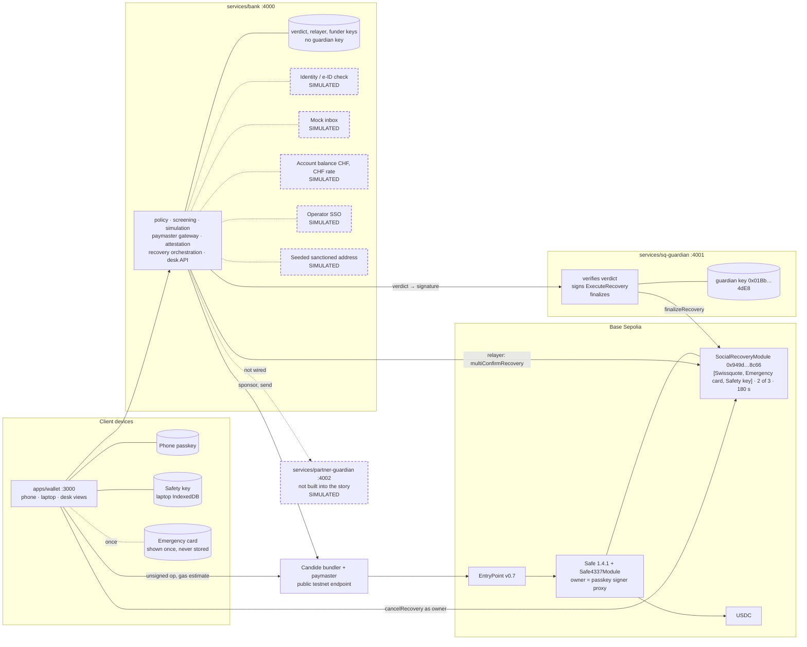

# Keyline

A self-custody wallet for Swissquote clients: the phone passkey alone moves funds, and a lost phone is recovered by any two of three recoverers (the client's Safety key, the client's Emergency card, Swissquote) after a public, cancellable on-chain delay. Swissquote is the only institution in the list, so it cannot move funds alone or with anyone.

Demo video (3 min): `TODO-FINAL: video link`

Screenshots: `TODO-FINAL: screenshot strip from docs/screens/README.md`

Built in 24 hours for the Swissquote track of the EPFL BSA hackathon, 5–6 Oct 2026, on Base Sepolia. Everything below describes the code in this repository as it is, not the plan. Simulated parts are marked SIMULATED in the UI, dashed in the diagrams and listed in section 3.

Contents: 1 Identity · 2 Custody decision and threat model · 3 Architecture · 4 Wallet creation · 5 Authentication · 6 Recovery · 7 Custody and Travel Rule · 8 Business case · 9 Bonus topics · 10 Bitcoin, limitations, verify · 11 Run it · 12 Tests and verification · 13 AI tools · 14 Sources

## 1. What it is

One Safe 1.4.1 smart account per client on Base Sepolia (ERC-4337, EntryPoint v0.7). Its only owner is a `SafeWebAuthnSignerProxy` bound to the client's phone passkey (P-256, verified by the RIP-7212 precompile). A Candide `SocialRecoveryModule` is enabled with three guardians and threshold 2. Transactions are sponsored by the bank through a paymaster after a policy check, decoded and simulated before signing, and screened against the OFAC SDN list. Wallet ownership is proven to the bank once, cryptographically, with an ERC-1271 attestation, which replaces screenshots for the FINMA Travel Rule check.

The story the demo tells, in order: create the wallet, sign a transfer, lose the phone, recover it, and watch a thief with the phone and the e-mail get refused.

## 2. Custody model decision and threat model

Chosen: a smart-contract account owned by a passkey, with threshold guardian recovery. Not chosen, and why:

| Model | Why not as the primary |
|---|---|
| Custodial account | Swissquote has full power of disposal: custody and segregation rules, no DeFi, no transfers to exchanges. The client gains nothing a bank account does not already give |
| Seed phrase | Lost or photographed by a typical client; no bank-assisted recovery without the bank becoming a custodian of the phrase |
| MPC / TSS 2-of-3 for everyday signing | No on-chain veto window: stolen or colluding shares move funds at once. Browser-ready TSS libraries are non-commercial-licensed. Kept as the Bitcoin roadmap |
| Shamir split backup | Reassembly puts the whole key in one place; if two institutions can reassemble it, that is joint power of disposal with no delay |
| Passkey Safe + guardian recovery (chosen) | Audited contracts (Safe, Safe4337Module, Candide module audited by Ackee); Sygnum ships the pattern; recovery is slow, public and cancellable; the client key alone always suffices. Weakness: EVM-only |

Who holds what in default mode, the only mode built:

| Key | Holder and location in the prototype | Can move funds | Recovery role |
|---|---|---|---|
| Phone key (passkey) | Client; platform authenticator, biometric or PIN gated | Yes, alone | Can cancel any recovery during the delay |
| Safety key | Client; software EOA in the laptop browser profile (IndexedDB) | No | Guardian 1 of 3 |
| Emergency card | Client; EOA key shown once at onboarding, never stored by the app, kept offline | No | Guardian 2 of 3. Unlike a seed phrase it cannot spend |
| Swissquote recovery key | `services/sq-guardian`, own process, own `.env`, own SQLite, EOA `0x01Bbd43cd140a7BfcA7836e577470Af2B1d04dE8` | No | Guardian 3 of 3. One signature of the two required |

Could Swissquote, alone or with a partner, move the funds?

Default mode. No. The Safe's owner list contains one address, the client's passkey signer proxy; the recovery module has no transfer function. The guardian list of every Safe the prototype creates is `[Swissquote, Emergency card, Safety key]` with threshold 2, and Swissquote is the only institution in it. There is no second institution with which to reach two. Any recovery that does reach two starts a 180 s grace period (production: days) during which the owner's phone cancels it on-chain. All of this is readable from the chain with the commands in section 10, and the guardian service itself refuses to sign for a wallet where it is not an on-chain guardian.

Assisted mode. Not built. The strategy describes an opt-in mode where the Emergency card is replaced by an independent recovery partner on a 14-day module instance. There, Swissquote and the partner together could complete a recovery without the client after 14 public days if the owner did not cancel. That is the legal grey zone (section 7) and we say so. The `partner-guardian` process exists as a skeleton and is never added to any guardian set, so the default-mode answer is the only one that applies to what is deployed.

One honest qualification. The wallet application generates the Emergency card and the Safety key in the client's browser. A malicious release could capture them. That is vendor trust, shared by every non-custodial wallet; it does not give Swissquote's recovery key any power, and the mitigation is open-source reproducible builds. The claim we make is "Swissquote's recovery key cannot act alone or with any other institution", not "the app can never misbehave".

Threat model (from `docs/STRATEGY.md` §3; the row-by-row account of what the code does today is in `docs/THREAT-MODEL.md`):

| Threat | Can they steal funds? | Can they lock the client out? | Mitigation | Demoed? |
|---|---|---|---|---|
| Thief with locked phone | No — the passkey needs biometrics/PIN | No | WebAuthn user verification; nothing to extract from the phone | Yes |
| Thief with phone **and** email | No | No | Email alone is never enough. Recovery needs an identity check the thief fails **and** a second guardian he does not have (laptop or emergency card); the attempt is public and logged. (Lea cannot cancel here — the thief holds her phone — so the threshold, not the veto, is the protection.) | **Yes (bonus)** |
| Fraudster with forged ID (bank fooled) while Lea still has her phone | No | No | Still needs a second guardian; if he also had her emergency card, the recovery executes but Lea's phone gets the alert and **cancels on-chain** during the delay | Yes (variant) |
| Thief with *unlocked* phone and PIN | Prototype: yes up to the Safe balance (the policy layer only withholds sponsorship; paying own gas bypasses it). Production: limited by on-chain allowance | **Yes, while he holds the unlocked phone**: he can cancel any recovery (veto griefing); there is no on-chain way to evict a holder of the owner key, in ours or any self-custody wallet | Production: Safe AllowanceModule + threshold 2 above the daily limit caps the damage; first-time-recipient cooling delay; the bank stops sponsoring and flags the account — stated plainly as the residual risk of self-custody | Explained |
| Malicious Swissquote insider / compromised bank verdict key / desk operator abusing "override" | **No** | No | Swissquote holds one guardian key; threshold 2; the second guardian is always client-held in default mode; on-chain delay + owner veto; every action logged | Explained |
| Swissquote + partner collude | Default mode: impossible on-chain (no partner). Assisted mode: only after 14 public days if the owner does not cancel | No | Assisted mode is opt-in, contractually constrained, notified on every channel; flagged as the grey zone | Explained |
| Swissquote goes offline / bankrupt | No | **No** | The Safe is on-chain; the phone key signs through any ERC-4337 bundler, paying own gas; Safety key + Emergency card recover to a new owner with no Swissquote involvement; the open-source app keeps running on a domain held in escrow so the phone passkey keeps working (passkeys are domain-bound — the one thing self-hosting cannot fix, see §4) | Yes (screen) |
| Bundler or paymaster outage | — | No | Any public bundler; "Pay my own fee" path | Explained |
| Client loses phone | — | Not permanently | Safety key + Swissquote (identity check) → recovery after delay | **Yes (core)** |
| Client loses phone, laptop and emergency card | — | Default mode: yes (true self-custody). Assisted mode: no | Client chooses at onboarding; explained plainly | Explained |
| Phishing / malicious dApp | Reduced | — | Simulation shows the asset diff in plain language; allowlist; sanctions screening; unlimited approvals flagged | Yes (bonus) |
| Compromised or malicious app release (XSS, rogue deploy) | In principle yes: the app generates the Emergency card and holds the Safety key, so malicious code plus Swissquote's guardian key reaches 3 of 3; it could also ask the passkey to sign an opaque hash | — | This is vendor trust, the same as for every non-custodial wallet (MetaMask, Zengo); legally still software, not custody. Mitigations: open-source reproducible builds on an escrowed domain, Safety key gated by user verification (PRF-encrypted) or on a hardware wallet, Emergency card generated on an independent offline page, step-ups shown on the laptop before signing. Said out loud: the honest claim is "Swissquote's recovery key cannot act alone", not "the app can never misbehave" | Explained |
| Bug in our code | — | — | We wrote no cryptography; all signing is library code; contracts are audited | Explained |

Corrections to the "Demoed?" column for the code as it stands: the "Swissquote gone" path is proven from the CLI (`pnpm keyline recover --without-bank`), not from a screen; the "Pay my own fee" UI path is not built (the CLI and `packages/chain` accept any bundler URL); the fraud variant's owner cancel is proven on-chain from the CLI, and the in-app Cancel button's on-chain run is not recorded.

## 3. Architecture

Full diagrams and sequence diagrams for the four flows: `docs/ARCHITECTURE.md`.



Real, simulated, out of scope. Built from `docs/MOCKS.md` and a grep for `SimulatedBadge` (12 wallet screens and 3 `packages/ui` components) and `simulated: true` (bank identity, recovery service, seed, decode fallback, pairing, rates, top-ups, core routes, recoveries, screening; `packages/chain` simulate fallback).

| Component | Status |
|---|---|
| Passkey creation and assertion (WebAuthn, `@simplewebauthn`) | Real; platform authenticators in the demo, CDP virtual authenticators in Playwright |
| Safe 1.4.1 + Safe4337Module v0.3.0 + EntryPoint v0.7, counterfactual address, deploy + protect in one sponsored userOp | Real, Base Sepolia |
| Passkey signer proxy, P-256 precompile `0x…0100` configured as verifier | Real (whether the precompile or the FCLP256Verifier fallback did the work was not measured separately) |
| Candide bundler and paymaster sponsorship | Real, public testnet endpoint `https://api.candide.dev/public/v3/84532`, no API key, no SLA. With no URL configured the bank returns 502, never a fake sponsorship |
| SocialRecoveryModule execute, finalize, cancel; 180 s grace read from the module as `executeAfter` | Real on-chain |
| Swissquote guardian: separate process, own key, own SQLite, own `.env` | Real process; software EOA key (production: HSM) |
| Guardian signatures (EIP-712 `ExecuteRecovery`), bank verdict signature (EIP-712 `KeylineIdentityVerdict`), Safety-key step-up signature (EIP-712 `KeylinePolicyStepUp`) | Real signatures, verified with viem |
| ERC-1271 ownership attestation verified by the bank | Real on-chain `eth_call` |
| Transaction simulation `eth_simulateV1` with asset changes | Real on `sepolia.base.org`; decode-only fallback after 8 s or RPC error is labelled `simulated: true` |
| Call decoding and risk words (`approve(∞)`, `permit`, `setApprovalForAll`, `enableModule`) | Real (pure viem `decodeFunctionData`) |
| Sanctions screening against the OFAC SDN ETH address list | Real list (live fetch at startup, vendored snapshot offline), plus one seeded test address labelled SIMULATED. SECO is a name list, noted not checked |
| USDC top-up from the bank funder EOA | Real transfer when the funder holds USDC; 502 with the real balances otherwise |
| Bank identity check, e-ID (swiyu) form, KYC re-verification | SIMULATED. Persona rules: device label "Thief" or a name mismatch fails |
| Recovery OTP e-mail | SIMULATED mock inbox `GET /mock/inbox/:email` |
| Swissquote account balance (CHF 12'500 seeded), CHF rate (1 USDC = CHF 0.80) | SIMULATED |
| Push notifications | SIMULATED, in-app alerts feed |
| Operator SSO for the desk | SIMULATED, one shared `DESK_OPERATOR_TOKEN` |
| Safety-key pairing channel (6-digit code via the bank) | SIMULATED pairing protocol; the key itself is real and client-held |
| Tier 2 step-up and Tier 3 cooling (60 s instead of 24 h) | Policy-layer enforcement only, labelled as such; production path (AllowanceModule, delay module) not built |
| Daily spend and sponsorship counters (20 sponsored ops per client per day) | Bank bookkeeping, not on-chain |
| DemoSwap and Unknown dApp in the allowlist | SIMULATED dApps (placeholder router address); Uniswap, Aave, Circle entries carry real Base Sepolia addresses not re-verified on-chain |
| Partner guardian, assisted mode, organisational independence | Not built. Process skeleton only; greyed out at onboarding |
| `X-Device-Label` header instead of the passkey session | Demo auth, enabled only with `DEMO_FAST_MODE=true` |
| Safety key as a passkey-signer contract or hardware key | Prototype simplification: software EOA in the laptop profile |
| Safety-key export | Plain JSON labelled prototype (no keystore library installed; homemade encryption is banned). The wallet's export button is not built; the CLI reads the file format |
| Bitcoin | Out of scope (section 10) |

Per-process powers (details in `docs/ARCHITECTURE.md` §2):

| Process | Can | Cannot |
|---|---|---|
| `apps/wallet` | Build unsigned userOps, ask the passkey to sign, sign recovery confirmations with the client's own keys, cancel a recovery as owner | Sponsor gas, issue verdicts, see any institutional key |
| `services/bank` | Evaluate policy, sponsor an op whose callData hashes to the evaluated calls, relay a signed op, verify attestations, sign identity verdicts, collect guardian signatures and submit `multiConfirmRecovery`, run the finalizer loop | Build or sign a Safe transaction, act as a guardian, move funds, finalize early |
| `services/sq-guardian` | Verify the bank verdict, check it is an on-chain guardian, sign one `ExecuteRecovery` approval, finalize after the delay | Build any Safe transaction, reach the threshold alone, act with a partner on a default-mode wallet |
| `services/partner-guardian` | Start and answer `/identity` | Anything in the story; not a guardian of any Safe |

## 4. Wallet creation

Where keys are generated and where they live:

| Key | Generated by | Lives in |
|---|---|---|
| Phone passkey | The platform authenticator during WebAuthn registration (`@simplewebauthn/browser`); the bank stores the public key (x, y) | Secure hardware of the phone or browser; never exported |
| Safety key | `viem.generatePrivateKey()` in the laptop browser (`apps/wallet/app/(laptop)/pair/page.tsx`) | The laptop profile's IndexedDB; the phone never receives it |
| Emergency card | `viem.generatePrivateKey()` in the phone browser (`apps/wallet/app/(client)/onboarding/page.tsx`) | Shown once as a 32-byte hex, confirmed, dropped from memory. Only its address is registered |
| Safe address | `abstractionkit` CREATE2 from the passkey public key, persisted by the bank and in the phone's `localStorage` | Never re-derived from the live passkey (after a recovery the passkey changes) |

The onboarding is six steps: create passkey, pair the laptop with a 6-digit code, write down the Emergency card, choose the recovery mode (Assisted is greyed out, SIMULATED), protect the wallet, prove ownership. "Protect" is one sponsored userOp that deploys the Safe, registers the passkey signer proxy as owner, enables the recovery module and adds the three guardians with thresholds 1, 2, 2. The passkey signs the SafeOp EIP-712 hash after the paymaster fields are attached (EntryPoint v0.7 order). The bank refuses to sponsor any op whose `callData` does not hash to the calls it evaluated.

Identity linkage. The client is already a KYC'd Swissquote client (seeded file, SIMULATED). Right after deployment the Safe signs `Attestation { clientId, address, chainId, nonce }` with a bank-issued single-use nonce; the bank verifies it with ERC-1271 against the deployed Safe (`eth_call isValidSignature` returned `0x1626ba7e` on `0x2eac8081f2c00f526369AabB7492abE2ec280dea`, two negative cases checked) and binds the address to the client file. Top-ups from the bank are only allowed to attested wallets.

## 5. Authentication

| Tier | Trigger | What the client does | Enforced in the prototype | Production path |
|---|---|---|---|---|
| 1 | ≤ CHF 1'000 per day, known recipient, allowlisted dApp | Phone passkey (biometric) | Policy engine approves; the bank sponsors and relays | Same, plus Safe AllowanceModule |
| 2 | Above the daily limit | Phone passkey + Safety key on the laptop | Policy layer: the laptop signs EIP-712 `KeylinePolicyStepUp(decisionId, wallet, callsHash, chfValueCents)`, the bank verifies it against the registered Safety key (`POST /policy/:id/step-up`) and the decision becomes approve. Labelled "policy-layer enforcement in the prototype" | Safe threshold 2 above the allowance |
| 3 | First transfer to a new address, or > CHF 10'000 | Tier 2 plus a waiting period with cancel | Policy layer: `cooling`, 60 s instead of 24 h, `POST /policy/:id/cancel` | Safe delay module |

Said plainly: in self-custody the client can bypass the policy layer by paying their own gas through any bundler. In the prototype nothing on-chain stops a thief with an unlocked phone. The policy layer is a protection the client opts into by using sponsored transactions, not a custody control. The on-chain production path is what would make the limits binding. The laptop screen that signs the Tier-2 step-up belongs to the Wave 3 wallet work; the bank route and the engine are built and tested.

Login to the wallet is a WebAuthn discoverable-credential assertion (`@simplewebauthn/server` v13, user verification required, ES256 only) that yields a 15-minute httpOnly session cookie. Every high-value action is also a passkey signature over a specific hash, never a session alone.

## 6. Recovery

Mechanism: Candide `SocialRecoveryModule`, 3-minute testing instance `0x949d01d424bE050D09C16025dd007CB59b3A8c66` (grace period 180 s, an immutable read from bytecode because the module has no getter; the UI shows `executeAfter` read from the module). Guardians confirm `(wallet, newOwners, newThreshold)`; at threshold the request is executed and the grace period starts; anyone finalizes afterwards; the current owner cancels during the period.

| Path | Who is involved | How long | Who pays gas | Built |
|---|---|---|---|---|
| Lost phone, has laptop (core demo) | New phone creates a passkey; bank identity check (SIMULATED) and signed verdict; `sq-guardian` verifies and signs; laptop Safety key signs; bank relayer submits one `multiConfirmRecovery(execute)`; finalize after 180 s | 180 s plus a few blocks | The bank relayer (today its Candide-sponsored relayer Safe `0x8Fadb595e6f3b59123c7A20c2c895C697816361a`; a plain EOA once funded) | Yes, from the UI (Gate 2) |
| Lost phone and laptop | Same, with the Emergency card typed into the new phone instead of the laptop | 180 s | Bank relayer | Confirm route accepts the card's signature; not run from the UI |
| Swissquote gone | Safety key file + Emergency card, no Keyline server at all: `pnpm keyline recover --without-bank` | 180 s | The client, from any funded account. The CLI used the public testnet sponsor because the test EOAs held 0 ETH | Yes, from the CLI (Safe `0x17049195C25b075c224AA05368287832F6d678c6`) |
| Attacker with phone and e-mail (bonus) | OTP passes, identity fails, request refused; desk override still leaves 1 of 2 | Never completes | Nobody; no transaction is sent | Yes, from the UI |
| Fraud while the owner has her phone | Executed with a forged pass and the card; the owner's phone shows an alert and cancels with a sponsored `cancelRecovery()` userOp | Cancelled inside the 180 s | Bank sponsors the cancel | Cancel proven on-chain from the CLI; alert and button exist in the app |
| Lost phone, laptop and card | No path in default mode (true self-custody). Assisted mode would add Swissquote + partner after 14 days | — | — | Assisted mode not built |

What stops an attacker. E-mail is never enough. The identity check and the guardian key are separate processes with separate keys; the guardian validates the bank's EIP-712 verdict (signature, `pass`, bound to this request, wallet and new owner), checks on-chain that it is a guardian of that wallet, refuses a second executed recovery within 24 h, and then signs exactly one approval. Threshold 2 means Swissquote never decides alone; the second guardian is client-held. The delay is on-chain and public. The owner's veto is on-chain. Every step is an append-only event shown in the desk, which has no function that moves funds.

The scripted thief. The attacker persona in the demo fails the identity step because the persona rules say so: a device label containing "Thief", or an e-ID name different from the client file, yields a signed `fail` verdict with reasons "ID document name mismatch" and "liveness check failed". The identity check is SIMULATED and the demo says so on screen. What the prototype proves is the second layer: with the desk's "override (demo)" button, the bank is deliberately fooled, Swissquote signs, and the request still stops at "waiting for a second recoverer" because the module needs two approvals.

Swissquote gone, with the passkey caveat. The recovery above never touches Swissquote. The passkey, however, is bound to the app's web domain (rpId). If the domain disappears, the phone key cannot sign through another origin; funds remain recoverable with the two client guardians, and day-to-day signing needs the open-source client self-hosted on a domain held in escrow. The "Exit hatch" screen that explains this and the wallet's "Export Safety key" button are not built at the time of writing; the CLI reads the exported file format.

## 7. Custody and Travel Rule

Full analysis with citations: `docs/LEGAL.md`.

Custody. The Swiss test is power of disposal (Art. 16 no. 1bis BankA, Art. 242a DEBA, FINMA Guidance 01/2026; MME, caplaw, IFLR on the DLT Act). Where the client can dispose of the assets alone, or several keys are needed and the provider cannot act alone, the assets are never in the provider's estate. In Keyline the phone key alone moves funds; Swissquote's key is one of three recovery guardians, cannot sign transactions, cannot complete a recovery alone, and any recovery is delayed and cancellable on-chain. Swissquote has no power of disposal. Keyline is software plus a recovery service, not custody and not a deposit. Consequences: no segregation booking, no custody insurance, no key-theft liability. We do not claim a capital saving; segregated custody is already off balance sheet. The gain is operational risk, liability and compliance cost.

Grey zone, said first. In default mode no two institutions are guardians, so the question does not arise on-chain. In the assisted mode we describe but did not build, Swissquote and a partner could reach the threshold without the client after 14 public days. FATF's 2021 guidance (§73) warns that multi-signature does not by itself exclude control. Our planned answer: the partner runs its own identity check and signs its own verdict, is contractually barred from cooperating outside a client-initiated request, and the 14-day on-chain delay with owner veto makes any joint action public and reversible. FINMA has not published a position on threshold-key arrangements; a no-action letter would be sought before launch (`docs/LEGAL.md` §7). AML still applies: Swissquote is a bank and every Keyline client is a fully identified client.

Travel Rule. FINMA Guidance 02/2019 and Art. 10 AMLO-FINMA allow a Swiss institution to transfer to or from an external wallet only if it belongs to its own client and ownership is proven by "suitable technical means", with no amount threshold (the CHF 1'000 figure is the identification threshold for exchange transactions, a different rule). Swissquote's wallet FAQ today asks for whitelisting with screenshots. Keyline replaces the screenshot with the ERC-1271 attestation of section 4, built and verified live. Who is the sending institution:

| Case | Flow | Swissquote's role | Obligation |
|---|---|---|---|
| 1 | Swissquote account → Keyline wallet | Orders a transfer to its own client's verified external wallet | The FINMA 02/2019 case; satisfied by the attestation |
| 2 | Keyline wallet → Swissquote account | Beneficiary institution; the sender is its own verified client | Same proof, same whitelist |
| 3 | Keyline wallet → third party | Does not order the transfer; sponsoring gas and screening is not ordering | Not the ordering institution. The receiving VASP can request a one-tap signed proof from the wallet. Not built |

If co-signing by the bank were mandatory, a conservative reading could make Swissquote a payment service provider. That is why co-signing stays optional and why the Tier-2 key is the client's own Safety key.

Data protection. The address-to-client link is bank-client confidential data (Art. 47 BankA) and personal data under the revised FADP; the guardian service is a critical process under FINMA Circular 2023/1. In production the three bank-side keys sit in Swiss HSMs; in the prototype they are EOA keys in per-process `.env` files.

## 8. Business case

Numbers, sources and assumptions: `docs/BUSINESS.md`.

Swissquote earned CHF 85.7 m from crypto in 2025 (about 12 % of CHF 723 m net revenue) but CHF 14.6 m in H1 2026, down 66 %, because that income follows trading volatility (FY2025 results, H1 2026 release). 18 % of Swiss residents hold crypto and trust matters more to them than price (HSLU/LUKB 2026); 66 % of crypto users call self-custody important but 33 % use it, 19 % citing complexity (Protocol Theory 2026). A Swissquote client who wants self-custody or DeFi today must leave: the wallet FAQ states that withdrawals to exchanges are not supported and external wallets need screenshots. Keyline keeps that client one tap from their account without Swissquote taking custody. Revenue that does not depend on volatility, illustrative: a 0.5 % in-wallet swap fee on 40 k wallets at CHF 4'000 a year (about CHF 0.8 m), non-custodial staking at the existing 20 % reward share on CHF 50 m (about CHF 0.25 m), a CHF 5 per month Protected tier for 20 k clients covering gas sponsorship, recovery and screening (about CHF 1.2 m): roughly CHF 2.25 m direct. The larger value is retention (each 1 % of 2025 crypto income is CHF 0.86 m) and acquisition (56 % of PostFinance crypto clients were new to investing). Costs fall: ownership checks become automatic, and there is no custody insurance, key-theft liability or segregation bookkeeping for assets the client holds. Precedents: eToro bought the non-custodial Zengo for about USD 70 m (Apr 2026); Revolut opened self-custody withdrawals (Dec 2025); Sygnum runs the guardian pattern on Safe RecoveryHub (Oct 2024). Every assumption is listed in `docs/BUSINESS.md` §6; nothing was validated with Swissquote staff.

## 9. Bonus topics

Gasless. Who pays: Swissquote, through the Candide paymaster; on the testnet the public endpoint's sponsor pays. Abuse prevention: the paymaster URL and any API key live only in the bank service; sponsorship is granted only for a `PolicyDecision` the engine approved, and only for a userOp whose `callData` hashes to the evaluated calls (`POST /userops/sponsor` recomputes `encodeCallData`); decisions expire after 10 minutes and are single-use once sent; 20 sponsored ops per client per day; screening and simulation must pass. The client can always pay their own gas through any bundler, so self-custody is preserved. The review screen shows "Network fee: paid by Swissquote" and the security centre shows the sponsored counter.

Compliant dApp interaction. Before signing, the bank returns: (1) `eth_simulateV1` asset changes in words ("You will send 2.50 USDC to Lukas Meier"), with a revert blocking the transaction; (2) decoded calls with risk words for `approve(∞)`, `permit`, `setApprovalForAll` and `enableModule` of an unknown module, plus a suggested cap that re-encodes an unlimited approve as 100 USDC; (3) OFAC SDN screening of the counterparty, blocking on a hit (one seeded test address, SIMULATED); (4) a dApp allowlist (`services/bank/policy/allowlist.json`): DemoSwap is allowlisted and its `approve(∞)` request is returned as step-up with a suggested cap, an unknown dApp is blocked with "request a review"; (5) tiers 2 and 3 as in section 5. The `/dapps` screen in the wallet is a placeholder at the time of writing; the bank route `GET /dapps` and `POST /policy/evaluate {kind: dapp}` are built and tested. Screenshots: `TODO-FINAL: review screen with "What will happen" and the blocked-screening screen, from docs/screens/README.md`.

## 10. Bitcoin, known limitations, verify our claims

Bitcoin. Keyline is EVM-only. ERC-4337, Safe, the recovery module and `eth_simulateV1` have no Bitcoin equivalent. The same policy, owner key now and 2-of-3 recovery keys after a timelock, is expressible natively in Bitcoin miniscript with relative timelocks (as Liana does), or as a 2-of-3 TSS key (FROST, cggmp21) under the same identity rules. Roadmap, not promised.

Known limitations.

| Limitation | Detail |
|---|---|
| Policy-layer step-up | Tiers 2 and 3 are verdicts that gate sponsorship, not on-chain rules; a thief with an unlocked phone who pays gas bypasses them |
| Software Safety key | An EOA key in the laptop profile's IndexedDB; production: hardware wallet key or PRF-encrypted key |
| Plain-JSON Safety-key export | No keystore library installed and homemade encryption is banned; production: EIP-2335 / Web3 keystore v3. The wallet's export button is not built |
| Simulated identity | Persona rules decide pass or fail; production: swiyu e-ID (live 1 Dec 2026) or KYC re-verification |
| Public Candide endpoint | No SLA, per-IP rate limit; an authenticated URL replaces it with an env change |
| Partner guardian and assisted mode | Not built; process skeleton only |
| `X-Device-Label` demo auth | With `DEMO_FAST_MODE=true` the bank accepts a device label header in place of the passkey session so Playwright and curl can drive it |
| Veto griefing | Any holder of the owner key can cancel any recovery; inherent to an owner veto |
| 24 h guardian rule | Armed only when the bank reports the execution (Option A); the guardian verifies against the chain before trusting it |
| Passkey domain binding | A lost domain strands the phone key for signing, not for recovery |
| Not built from the strategy | Exit hatch screen, "Pay my own fee" UI, laptop Tier-2 approval screen, `/dapps` screen, ERC-7730 descriptors, real OFAC list refresh schedule |

Verify our claims. Foundry `cast` against the public RPC. Module `M`, Safe `S` created from the UI with a virtual authenticator (protect tx `0xa40c042a5774cd1fec93c9832d00311611fd6bd34896ef0b3a21be7e1850d425`).

```sh
RPC=https://sepolia.base.org
M=0x949d01d424bE050D09C16025dd007CB59b3A8c66
S=0x291A6d162dc3bfa2c7a5B623d676cFeF4CEc4482
SQ=0x01Bbd43cd140a7BfcA7836e577470Af2B1d04dE8

# Who can recover: three addresses, exactly one of them Swissquote's
cast call $M "getGuardians(address)(address[])" $S --rpc-url $RPC
# How many must agree: 2
cast call $M "threshold(address)(uint256)" $S --rpc-url $RPC
# Swissquote is a guardian, and one guardian is below the threshold
cast call $M "isGuardian(address,address)(bool)" $S $SQ --rpc-url $RPC
# Who owns the Safe: one address, the passkey signer proxy
cast call $S "getOwners()(address[])" --rpc-url $RPC
# Recovery module enabled
cast call $S "isModuleEnabled(address)(bool)" $M --rpc-url $RPC
# Recovery nonce (bumps when a recovery is executed)
cast call $M "nonce(address)(uint256)" $S --rpc-url $RPC

# The recovered Safe from the Gate 2 UI run: owner is the new phone's proxy
cast call 0xeF2c271d40d72bc5Dc4fef277846CA66886E2cce "getOwners()(address[])" --rpc-url $RPC
# expected: [0x07dDC4D0DfF95022806Ec4931EBB8cfF89fd016A]
```

`pnpm keyline guardians --safe <addr>` prints the same facts with a Basescan link. The grace period has no getter; the module bytecode holds the immutable 180 (`docs/VERIFIED.md` §2).

## 11. Run it

Prerequisites: Node 22 or newer (built on 24.8), pnpm 10, Foundry `cast` for the verification block (optional). No Candide API key is needed on the testnet.

```sh
pnpm i
cp .env.example .env                           # shared vars; then one .env per process:
#   services/bank/.env            BANK_* keys (verdict, relayer, funder; viem generatePrivateKey), BANK_CANDIDE_*_URL,
#                                 BANK_JWT_SECRET, DESK_OPERATOR_TOKEN, SQ_GUARDIAN_URL
#   services/sq-guardian/.env     GUARDIAN_KIND=swissquote, GUARDIAN_PRIVATE_KEY, BANK_VERDICT_ADDRESS, GUARDIAN_CANDIDE_URL
#   apps/wallet/.env.local        NEXT_PUBLIC_BANK_URL, NEXT_PUBLIC_CHAIN_ID, NEXT_PUBLIC_EXPLORER, WALLET_RP_ID, WALLET_ORIGIN
pnpm dev                                       # wallet :3000, bank :4000, sq-guardian :4001 (turbo)
pnpm dev:partner                               # adds partner-guardian :4002 (not used by the story)
```

| Command | What it does |
|---|---|
| `pnpm demo:reset` | Wipes the SQLite files, reseeds, prints EOA balances and faucet links |
| `pnpm demo:predeploy` | Deploys and protects a fallback Safe and a twin wallet for the pitch; writes `data/demo-state.json` |
| `pnpm demo:stage-recovery [--finalize]` | Executes (and optionally finalizes) a recovery on the twin wallet so the 180 s countdown fits a 3-minute pitch |
| `pnpm demo:open` | Opens five isolated Chrome instances, one per persona |
| `pnpm test` | vitest across packages and services |
| `pnpm e2e` | Playwright story with CDP virtual authenticators against a running stack and Base Sepolia (video on) |
| `pnpm lint` | biome and typecheck |
| `pnpm keyline guardians\|status\|recover --without-bank` | CLI against the chain only; `recover --without-bank` needs no Keyline server |

Personas are selected with `?device=`: `lea-phone` (`/`), `lea-laptop` (`/approve`, `/pair`), `lea-new-phone` (`/recover`), `thief` (`/`, red bar), `desk` (`/desk`). The label is shown in the device bar and logged by the bank as `X-Device-Label`. The thief persona has the phone but no passkey. Real platform passkeys in the live demo; virtual authenticators only in Playwright.

The bank's `GET /health` reports `paymasterEnabled`; the guardian's reports `chainPort: 'real'` and the finalize submitter.

## 12. Tests and verification

`TODO-FINAL: test counts per package from pnpm test (commit messages: chain 46, bank 115, guardian-core 26; e2e 6 passed, 5 skipped while the funder held no USDC)`

Unit tests (vitest): policy engine tables, screening (seeded and real OFAC hits), guardian rules, verdict verification, recovery hash parity with the module (`hashTypedData == getRecoveryHash`), `encodeCallData` parity with abstractionkit, live `eth_simulateV1`, live ERC-1271 attestation with two negative cases. E2E (Playwright, `e2e/story.spec.ts`): F1.1 to F1.7 and F2 run against Base Sepolia with every "it worked" checked on-chain, not on UI copy; F3, F4 and F4b are `test.fixme` and run manually from the UI. CI (`.github/workflows/ci.yml`) runs lint and unit tests on push; the story needs a funded stack and runs locally.

Recorded transactions on Base Sepolia (Basescan: `https://sepolia.basescan.org/tx/<hash>`):

| What | Safe | Transaction |
|---|---|---|
| Create + protect from the UI, passkey-signed, sponsored (Gate 1) | `0x291A6d162dc3bfa2c7a5B623d676cFeF4CEc4482` | `0xa40c042a5774cd1fec93c9832d00311611fd6bd34896ef0b3a21be7e1850d425` |
| USDC transfer from the UI (Gate 1, second leg) | | `TODO-FINAL: USDC transfer hash once the funder holds USDC` |
| ERC-1271 attestation Safe | `0x2eac8081f2c00f526369AabB7492abE2ec280dea` | create `0xf317b51d0f9b3932eb2ddcc1f113ae0e3e3e90de6ea3309cdee7a5d9637785c3`; verification is an `eth_call` |
| Recovery from the UI: execute, then finalize (Gate 2) | `0xeF2c271d40d72bc5Dc4fef277846CA66886E2cce` | execute `0xe56ca70dadcf94b0ff840ebfb80be0f3a2d69764a029b5c1fac56d3b2652d7f5` · finalize `0xad898b42a5b7696fef18c4680ba96b70d397e1482ad26bc8b01e5f8db0213e53` |
| Recovery execute, then finalize, 0 ETH on every EOA (chain spike) | `0x10b6b8542f734863C6b90703e522B22DF19f1628` | execute `0xb53f58a60c2202e499d9ed130b2fe56a328f2a6b885ee15f9190a5c0a2ef26e5` · finalize `0xcad741a3c66c039b28b41696492026839921ff5d13d7358207126cbecd51b874` |
| Recovery execute, then owner cancels | `0x10b6b8542f734863C6b90703e522B22DF19f1628` | execute `0xc612a175a1e03f0cfee7de3a028a3e4c2112cddb8486c0a9fc89f618ff78ebc1` · cancel `0x5ba3e0db186f726f04c14c46211a52d37eec486d79418a1880ab3ceef0a931f9` |
| Recovery without Swissquote (`keyline recover --without-bank`) | `0x17049195C25b075c224AA05368287832F6d678c6` | execute `0x7f7254b7ca8b5ced992d042052aeadb0d9302b9616bc588e7be1570dc3ae75cd` · finalize `0xfad34f525dd19f01862aa581c0227c9ee7673288b9ae8d81e490c90cb28a16c8` |

Full list and method: `docs/VERIFIED.md`. Process state: `docs/DECISIONS.md`.

## 13. AI tools used

Full account: `docs/AI-TOOLS.md`.

One person built this with Claude Code (model Claude Fable 5.1) as the engineering team: an orchestrator session that planned waves and gates, assigned work, integrated results, ran lint, test and typecheck gates and kept the decisions log; and seven subagents defined in `.claude/agents/`, each owning a directory. `account-chain` wrote `packages/chain` and the chain spikes and verified every address and SDK export against Base Sepolia (`docs/VERIFIED.md`); `bank-backend` wrote `services/bank` and the shared contracts; `guardian-services` wrote the guardian processes; `wallet-client` wrote `apps/wallet`; `design-system` wrote `packages/ui` and audited every screen; `qa-demo` wrote the Playwright story and the demo scripts; `docs-submission` wrote this README and the documents under `docs/`. Claude (chat) produced the strategy kit before the hackathon from public sources; secondary-source facts are marked in `docs/SOURCES.md` §7.

The human chose the track and the custody design, approved every decision in `docs/DECISIONS.md` (Candide public endpoint, Option A guardian signatures, plain-JSON export, cut list), created accounts and clicked faucets, prepared the Chrome profiles with real passkeys, read every gate report before the next wave, checked the custody wording against the on-chain guardian list, and presents the demo. The models wrote no cryptography; all signing is library code. Where the models were wrong (SPEC listed v0.2.1 signer addresses as v0.2.0; assumed a grace-period getter; the module's GitHub main differs from the deployed version; re-deriving the Safe from the passkey breaks after recovery) the error was caught by verification against the chain or the installed package and is recorded in `docs/AI-TOOLS.md` §5.

## 14. Sources

All URLs: `docs/SOURCES.md`. Main ones:

- FINMA Guidance 02/2019 "Payments on the blockchain"; FINMA Guidance 01/2026 on crypto custody; Art. 16 no. 1bis BankA and Art. 242a DEBA (DLT Act); Art. 10 AMLO-FINMA; FATF October 2021 guidance §73 (via Notabene); 21 Analytics on the Swiss Travel Rule and the Satoshi test; AOPP constraints (Notabene); MME, caplaw and IFLR on power of disposal; Schellenberg Wittmer on non-custodial providers and the AMLA; revised FADP; FINMA Circular 2023/1.
- Swissquote FY2025 results, H1 2026 media release and earnings call; Swissquote wallet FAQ, pricing and staking pages; Swissquote Education blog on key compromise losses; HSLU/LUKB 2026 study; Protocol Theory 2026 survey; finews on PostFinance; CoinDesk on eToro and Zengo; crypto.news on Revolut; Sygnum and Safe on RecoveryHub.
- Candide abstractionkit docs, deployments and authenticated endpoints; Ackee audit of the SocialRecoveryModule; Safe passkey and 4337 module repositories; ERC-4337, ERC-1271, ERC-6492, EIP-712, RIP-7212; viem; SimpleWebAuthn; 0xB10C OFAC SDN address list; Base Sepolia explorer and RPC.
- Our own proofs on Base Sepolia: `docs/SOURCES.md` §6 and `docs/VERIFIED.md`.
