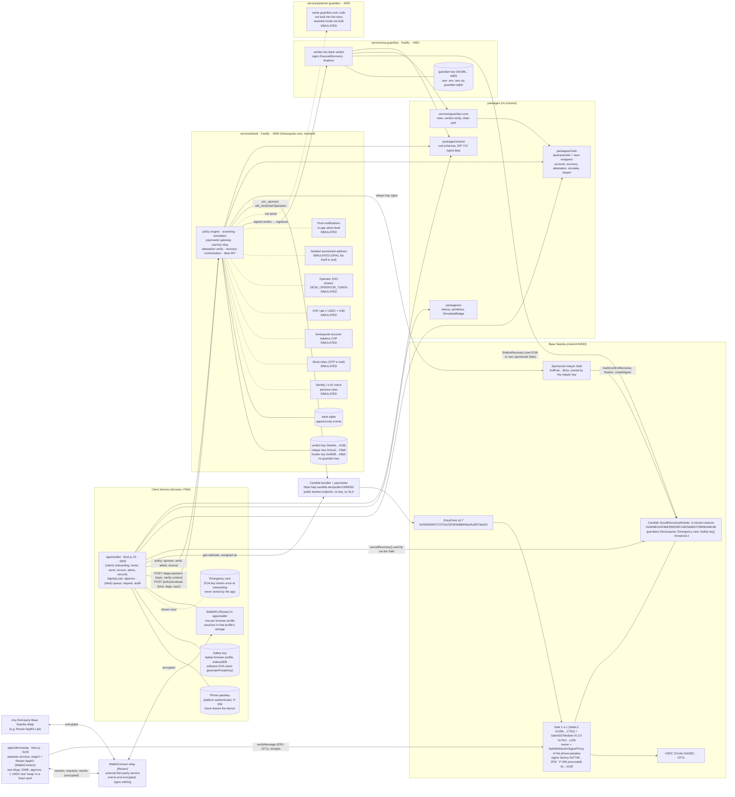
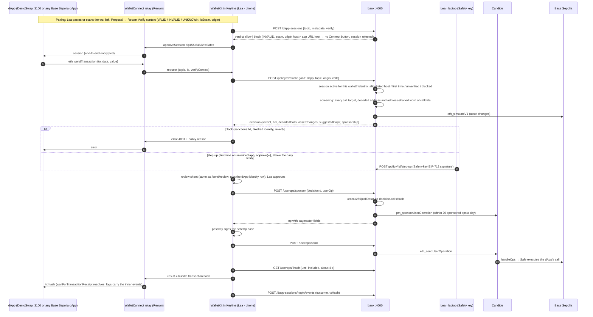
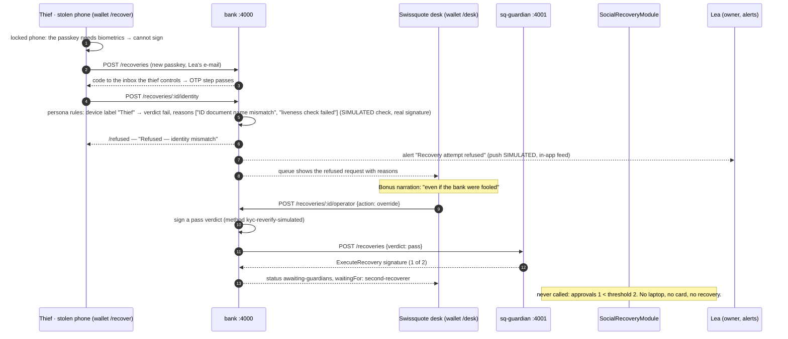

# Architecture

Owner: `docs-submission`. State of the code: the freeze of 6 Oct 2026, 09:15 CEST (commit `ae4f253`). Every box below is a process, package or contract that exists in the repository. Dashed boxes carry the word SIMULATED and are listed in `docs/MOCKS.md`. Anything the strategy promised that the code lacks is marked "not built". The WalletConnect parts (SPEC §11: WalletKit in the wallet, the Reown relay, `apps/demoswap`, the bank's `/dapp-sessions`) were added on 11 Oct 2026 from the code as it stands that day.

## 1. Components



Notes on the diagram.

- WalletConnect: the relay only carries end-to-end encrypted messages between a dApp and the wallet's WalletKit; it holds no key to the Safe, cannot read the requests and cannot sign anything. DemoSwap is a dApp like any other: it reaches Keyline only through the relay, and the wallet answers with the bank's policy in the loop (sequence below).
- The wallet builds every unsigned userOp itself (`apps/wallet/src/lib/chain.ts`, `buildUserOp` from `packages/chain`) and estimates gas on the public Candide endpoint. The bank only sponsors and relays (DECISIONS #14).
- The partner guardian is the same `guardian-core` server with `GUARDIAN_KIND=partner`. No code adds it to a guardian set. Assisted mode is not built; onboarding shows it greyed out with a SIMULATED badge.
- The OFAC SDN ETH address list is real (live fetch at startup, vendored snapshot offline, `services/bank/src/screening/ofac.ts`). Only the one seeded demo address is simulated.
- Verified contract addresses: `docs/VERIFIED.md` §2. Demo EOAs: `docs/ADDRESSES.md`.

## 2. What each process can and cannot do

| Process | Holds | Can | Cannot |
|---|---|---|---|
| `apps/wallet` (phone, laptop, desk views of one Next.js app) | Only client material: the passkey lives in the platform authenticator; the Safety key EOA sits in the laptop profile's IndexedDB; the Emergency card is generated with viem and displayed once; the Safe address is persisted in `localStorage` (`keyline.wallet`) and never re-derived | Build unsigned userOps, ask the passkey to sign the SafeOp hash, send `cancelRecovery()` as the owner, sign `ExecuteRecovery` with the Safety key, show decoded calls and the simulation before signing | Sponsor gas (no Candide key), issue identity verdicts, act as any guardian other than the client's own, see any institutional key |
| `services/bank` (:4000) | Verdict key, relayer key, funder key, bank.sqlite | Evaluate policy (tiers, limits, allowlist, screening, simulation), attach paymaster data to an unsigned userOp whose `callData` hashes to the evaluated calls, relay a client-signed userOp, verify the ERC-1271 attestation, sign an EIP-712 identity verdict, collect guardian signatures and submit one `multiConfirmRecovery`, deploy the new passkey's signer proxy, run the finalizer loop, serve the desk | Build or sign a Safe transaction (it holds no owner key and recomputes `encodeCallData` only to verify), act as a guardian (the verdict key is not in any guardian list), move funds, finalize before `executeAfter` (the module refuses) |
| `services/sq-guardian` (:4001) | Guardian key, sq-guardian.sqlite; refuses to start with any `BANK_*` secret or `WALLET_*` variable in its environment | Verify the bank's verdict signature against `BANK_VERDICT_ADDRESS`, check it is an on-chain guardian of that wallet, sign `ExecuteRecovery` at the live module nonce (one approval of two), record an execution after checking the chain, send `finalizeRecovery` after `executeAfter` | Build any Safe transaction (the chain port exposes recovery reads, `confirmRecovery`, `finalizeRecovery` only), reach the threshold alone, finalize early, act with the partner on a default-mode wallet (the partner is not in the guardian list) |
| `services/partner-guardian` (:4002) | Its own key and SQLite | Start, answer `/identity` and `/health` | Anything in the story: it is never a guardian of any Safe the prototype creates. Not built into onboarding or recovery |
| `apps/demoswap` (:3100) | Nothing but its own UI state; it never sees a key | Propose a WalletConnect session, ask for sign-in, signatures, transactions and batches, verify the Safe's signature with viem `verifyMessage`, read receipts | Sign for the client, reach the bank (except a server-side read of the seeded sanctioned address via `GET /contacts`), bypass the wallet's review |
| WalletConnect relay (Reown) | Encrypted envelopes in transit | Deliver messages between a dApp and the wallet | Read them (end-to-end encrypted), sign anything, approve a session or a request |
| Candide bundler + paymaster | Sponsorship policy | Include userOps, pay gas on the testnet | Sign for anyone; the bank's sponsorship decision gates which ops reach it |

## 3. Sequence diagrams

### F1 Create and protect

```mermaid
sequenceDiagram
  autonumber
  participant P as Lea · phone (wallet)
  participant L as Lea · laptop (wallet /pair)
  participant B as bank :4000
  participant G as sq-guardian :4001
  participant C as Candide (bundler + paymaster)
  participant S as Base Sepolia (EntryPoint, Safe, module)

  P->>P: WebAuthn create (platform passkey, P-256 x,y saved)
  P->>B: POST /wallets {pubKeyX, pubKeyY, credentialId}
  B-->>P: counterfactual Safe address (abstractionkit CREATE2)
  P->>B: POST /pairings → 6-digit code (SIMULATED pairing channel)
  L->>L: viem generatePrivateKey → Safety key (IndexedDB)
  L->>B: POST /pairings/:code/claim {safety-key, address}
  P->>P: viem generatePrivateKey → Emergency card, shown once, dropped
  P->>B: POST /wallets/:a/guardians {emergency-card, address}
  P->>B: POST /wallets/:a/guardians {swissquote}
  B->>G: GET /identity
  G-->>B: guardian address 0x01Bb…4dE8 (key never leaves G)
  P->>B: POST /policy/evaluate {kind: protect}
  B-->>P: decision: calls = enableModule + 3 × addGuardianWithThreshold (1,2,2), callsHash
  P->>C: eth_estimateUserOperationGas (unsigned op, dummy signature)
  P->>B: POST /userops/sponsor {decisionId, userOp}
  B->>B: keccak256(userOp.callData) == callsHash (incl. createSigner + swapOwner prefix)
  B->>C: pm_sponsorUserOperation
  B-->>P: userOp with paymaster fields
  P->>P: passkey signs the SafeOp EIP-712 hash (WebAuthn challenge)
  P->>B: POST /userops/send {decisionId, signed userOp}
  B->>C: eth_sendUserOperation
  C->>S: handleOps → deploy Safe, createSigner, swapOwner, enableModule, addGuardian × 3
  P->>B: GET /userops/:hash (poll)
  B-->>P: included, txHash → receipt with Basescan link
  P->>B: GET /attestations/:wallet/challenge → bytes32 nonce, typed data
  P->>P: passkey signs SafeMessage(Attestation{clientId, address, chainId, nonce})
  P->>B: POST /attestations {signature}
  B->>S: eth_call Safe.isValidSignature (ERC-1271) → 0x1626ba7e
  B-->>P: attested; address bound to the KYC file (whitelist both ways)
```

Signing order is fixed by EntryPoint v0.7: build with a dummy signature, sponsor, sign the SafeOp hash, send. The passkey never signs before the paymaster fields are in the op.

### F2 Sign a transfer

```mermaid
sequenceDiagram
  autonumber
  participant P as Lea · phone (wallet)
  participant L as Lea · laptop (Safety key)
  participant B as bank :4000
  participant R as RPC sepolia.base.org
  participant C as Candide
  participant S as Base Sepolia

  P->>B: POST /policy/evaluate {kind: transfer, calls: [USDC.transfer(to, amount)]}
  B->>B: screening: OFAC SDN ETH list (real) + seeded test address (SIMULATED), SECO note
  B->>R: eth_simulateV1 (viem simulateCalls, traceAssetChanges), 8 s timeout → decode-only fallback
  B->>B: tiers: CHF value at the static rate (SIMULATED) → approve | step-up | cooling | block
  B-->>P: decision {verdict, decodedCalls, assetChanges, screening, sponsorship, reasons}
  alt step-up (Tier 2, above CHF 1'000/day)
    L->>B: POST /policy/:id/step-up {Safety-key EIP-712 KeylinePolicyStepUp signature}
    B->>B: verifyTypedData against the registered Safety key → approve (policy layer only)
  else cooling (Tier 3, new recipient or > CHF 10'000)
    B-->>P: coolingUntil = now + 60 s (demo value); POST /policy/:id/cancel stops it
  else block
    B-->>P: 403 policy-refused with the reason shown verbatim; no sponsorship
  end
  P->>C: estimate gas (unsigned op)
  P->>B: POST /userops/sponsor {decisionId, userOp}
  B->>B: callData hash == decision.callsHash
  B->>C: pm_sponsorUserOperation
  B-->>P: op with paymaster fields
  P->>P: passkey signs the SafeOp hash
  P->>B: POST /userops/send
  B->>C: eth_sendUserOperation
  C->>S: handleOps → Safe executes USDC.transfer
  P->>B: GET /userops/:hash → included, txHash
```

Enforcement note. Tier 2 and Tier 3 are policy-layer verdicts: they decide whether the bank sponsors and relays. A userOp paid with the Safe's own ETH through any bundler bypasses them. The on-chain production path (Safe AllowanceModule, threshold 2 above the allowance, delay module) is not built. The laptop screen that signs the Tier-2 step-up (`apps/wallet/app/(laptop)/approve/page.tsx`), the phone's step-up and cooling states (`send/review/page.tsx`) and the bank routes are all built; Gate 3 confirmed a Tier-2 operation on-chain (wallet `0x3cfC079f1fFA8C66DC40B2B115fAcc8963F0D7E2`, DECISIONS #22).

### F2b dApp transaction over WalletConnect (SPEC §11)



`wallet_sendCalls` takes the same path with every call in one batched userOp and answers `{ id: userOpHash }`; `wallet_getCallsStatus` then answers the EIP-5792 v2 shape from the bundler receipt. Sign-in, `personal_sign` and typed data stay in the wallet: decoded on a review sheet, signed by the passkey as a Safe message (ERC-1271), answered through the relay and logged as a bank event; they do not go through `/policy/evaluate`. A declined request answers `USER_REJECTED`; one past its WalletConnect expiry is shown as expired.

### F3 Lose the phone and recover (Option A, DECISIONS #15)

```mermaid
sequenceDiagram
  autonumber
  participant N as Lea · new phone (wallet /recover)
  participant L as Lea · laptop (wallet /approve)
  participant B as bank :4000
  participant G as sq-guardian :4001
  participant RS as Relayer (sponsored relayer Safe 0x8Fad…361a or relayer EOA)
  participant M as SocialRecoveryModule 0x949d…8c66

  N->>N: WebAuthn create → new passkey (x, y)
  N->>B: POST /recoveries {wallet, email, new passkey}
  B->>RS: factory.createSigner(x, y) → new SafeWebAuthnSignerProxy (real tx)
  B-->>N: request id; 6-digit code sent to the mock inbox (SIMULATED e-mail)
  N->>B: code from GET /mock/inbox/:email
  N->>B: POST /recoveries/:id/identity {e-ID form from POST /mock/eid}
  B->>B: persona rules (SIMULATED identity check): device label, e-ID name vs client file
  B->>B: sign EIP-712 KeylineIdentityVerdict {requestId, wallet, newOwner, verdict: pass} with the verdict key (real signature)
  Note over B: DEMO_FAST_MODE signs at once; otherwise the desk operator approves (SIMULATED SSO)
  B->>G: POST /recoveries {request, newOwners: [proxy], newThreshold: 1, verdict}
  G->>G: rule 1 verify verdict signature vs BANK_VERDICT_ADDRESS · rule 2 verdict == pass · rule 2b bound to this request/wallet/owner
  G->>M: isGuardian(wallet, self)? nonce(wallet)? no execution in the last 24 h (rule 4, 5)
  G->>G: signTypedData ExecuteRecovery(wallet, newOwners, 1, nonce) with the guardian key
  G-->>B: {signer: 0x01Bb…4dE8, signature, nonce}  (1 of 2)
  L->>B: GET /recoveries/:id/typed-data
  L->>L: Safety key signs the same ExecuteRecovery hash
  L->>B: POST /recoveries/:id/confirm {signer, signature}
  B->>B: verifyTypedData, nonce still current, signer is a registered client recoverer
  B->>RS: multiConfirmRecovery(wallet, [proxy], 1, [sq, safety] sorted, execute = true)
  RS->>M: approvals 2 ≥ threshold 2 → executeAfter = block.timestamp + 180 s
  B->>G: POST /recoveries/:id/executed {txHash, executeAfter}
  G->>M: status(wallet).pending and executeAfter match? → record, arm the 24 h rule
  N->>B: GET /recoveries/:id (poll) → executeAfter read from the module
  Note over N: countdown shows the on-chain deadline; the old phone could still cancel here
  loop bank finalizer loop
    B->>G: POST /recoveries/:id/finalize (after executeAfter)
    G->>M: finalizeRecovery(wallet) from the guardian EOA or its own sponsored Safe
  end
  M-->>N: getOwners() = [new proxy]; "Welcome back, Lea"
```

Proofs. Gate 2 run from the UI (DECISIONS #20): execute `0xe56ca70d…2d7f5`, finalize `0xad898b42…13e53`, Safe `0xeF2c271d40d72bc5Dc4fef277846CA66886E2cce`, owner `0x07dDC4D0DfF95022806Ec4931EBB8cfF89fd016A`. Earlier chain-level proofs with 0 ETH on every EOA: `docs/VERIFIED.md` §12.

### F4 Attacker refused; override still waits



Variant F4b, fraud while Lea still has her phone: if the attacker also held the Emergency card, the request would execute and Lea's phone would show the alert with a Cancel button. The cancel is an owner userOp (`POST /policy/evaluate {kind: cancel-recovery}` → sponsor → passkey signs → send → `cancelRecovery()`), proven on-chain from the CLI (`docs/VERIFIED.md` §12b, tx `0x5ba3e0db…a931f9`). The in-app path exists in `/alerts`; its on-chain run from the UI is not recorded.

## 4. Data and keys per process

| Store | Process | Content |
|---|---|---|
| `services/bank/data/bank.sqlite` | bank | clients (seeded Lea, SIMULATED balance), wallets, pairings, guardians, decisions, sponsorships, attestations, recoveries, inbox, events (append-only, SQLite triggers); dApp sessions (topic, metadata, Verify context, status) |
| `services/sq-guardian/data/sq-guardian.sqlite` | sq-guardian | recovery confirmations, executions, events (append-only) |
| Browser profile | wallet | `localStorage`: device label, Safe address, local transfer list, pending recovery; IndexedDB: Safety key (laptop only); WalletKit's default store (IndexedDB / `localStorage`): WalletConnect sessions and their encryption keys, per profile |
| Platform authenticator | phone | passkey private key (never exported) |
| Paper | client | Emergency card (32-byte hex) |

Environment: one `.env` per process from the root `.env.example`. The guardian process refuses to start if it sees bank or wallet variables.
